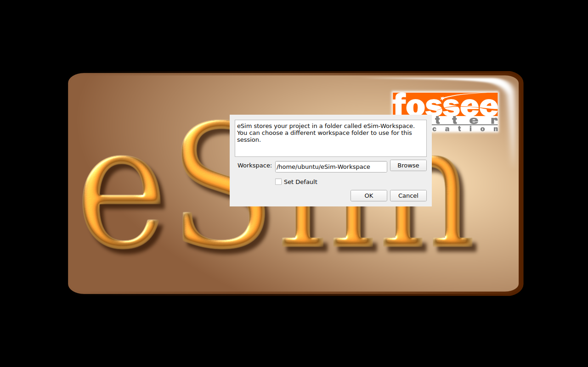
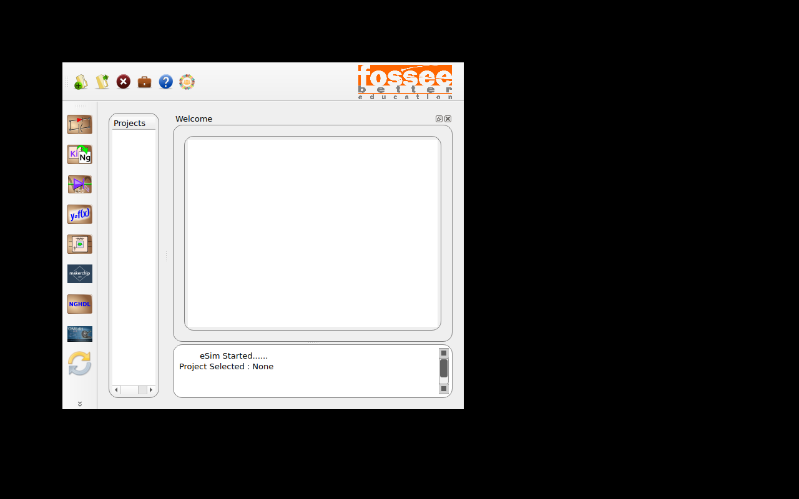

# eSim 2.5 on Ubuntu 25.04: installation problems and fixes

Screening task 4 (eSim Upgradation), FOSSEE Winter Internship 2026. Tested on 2026-11-15.

This report lists every problem found while installing eSim 2.5 on Ubuntu 25.04, how each
was found, why it happens, and what was changed to fix it. Raw evidence (log excerpts and
screenshots) is in [`25.04-test-evidence/`](25.04-test-evidence/). It is separate from the
existing [`REPORT.md`](REPORT.md); section 8 explains how the two relate.

**Result:** with the changes in this branch, the eSim 2.5 installer completes on a clean
Ubuntu 25.04 container in one pass (exit code 0), and eSim starts and shows its main window
([screenshot](25.04-test-evidence/eSim-2.5-main-window.png)).

## 1. Summary of problems

| # | Problem | Found by | Blocks install? | Fixed in |
|---|---|---|---|---|
| P1 | Official `eSim-2.5.zip` has no 25.04 support | Reproduced | Yes | `install-eSim.sh` (25.04 case), `install-eSim-25.04.sh` |
| P2 | `installers` dispatcher has a syntax error (line 70) | Reproduced | Yes, on every version | `install-eSim.sh` rebuilt |
| P3 | Ubuntu version detection prints nothing on 25.04 | Reproduced | No (cosmetic) | `install-eSim.sh` |
| P4 | `add-apt-repository`, `lsb_release`, `unzip`, `file` never installed | Reproduced | Yes, on minimal systems | `install-eSim-25.04.sh` |
| P5 | `nghdl.zip` has no 25.04 support and eSim hides the failure | Reproduced | Yes | `install-eSim-25.04.sh`, `nghdl-25.04/` |
| P6 | `libcanberra-gtk-module` removed from Ubuntu | Reproduced | Yes (NGHDL) | `nghdl-25.04/` |
| P7 | GHDL 4.1.0 cannot be built with LLVM 20 | Reproduced | Yes (NGHDL) | `nghdl-25.04/` |
| P8 | GHDL build calls an unversioned `clang++` | Reproduced | Yes (NGHDL) | `nghdl-25.04/` |
| P9 | `apt install` without `-y` | Code review | No (hangs unattended runs) | `install-eSim-25.04.sh` |
| P10 | KiCad "already installed" ends the whole installer | Code review | Yes, if KiCad 8 is present | `install-eSim-25.04.sh` |

"Reproduced" means the failure was seen in a run and an excerpt is in the evidence folder.
"Code review" means it was found by reading the script; the test runs did not trigger it.

### Difficulty: what each problem interrupts

The installer runs its steps in this order: configuration file, system and Python
dependencies, KiCad, KiCad libraries, NGHDL (GHDL, Verilator and ngspice), the SKY130 PDK,
and **last of all** the `esim` launcher and desktop entry. A failure at any earlier step
leaves no `esim` command, so the main eSim GUI cannot be started.

| What it interrupts | Problems |
|---|---|
| Everything, at the first step | P1, P2 |
| The KiCad step, before the GUI launcher is created | P4 |
| The NGHDL step. NGHDL is not the GUI itself, but this installer treats it as mandatory and stops, so the GUI launcher is never created | P5, P6, P7, P8 |
| Ends the installer early, before the launcher, on a system that already has KiCad 8 | P10 |
| No failure, only reliability or cosmetics | P3, P9 |

## 2. Test environment

| Item | Value |
|---|---|
| OS | Ubuntu 25.04 "plucky", official `ubuntu:25.04` Docker image |
| Host | GitHub Codespaces, x86_64, 2 vCPU, 8 GB RAM (Docker-in-Docker) |
| Package | `eSim-2.5.zip` from `https://static.fossee.in/esim/installation-files/eSim-2.5.zip`, 100,868,880 bytes |
| SHA-256 | `b9860ae26f026930bae589520761f4a57b85d593a2e2cd1ac83d5e5db2f281ed` |
| User | non-root `ubuntu` user with passwordless `sudo`, as on a normal desktop |
| Input | answered `n` to the proxy question, `y` to other prompts |

A container was used instead of a full virtual machine. It runs the real Ubuntu 25.04
userland and package archive, but it has no init system or display, so a virtual display
was used for the screenshots (section 4).

Setup that is **not** counted as an eSim bug: the bare container had no timezone (a
`tzdata` prompt looped on "Geographic area:"), so a timezone was set. `sudo` and
`ca-certificates` were installed because a bare image has neither. In the final run,
`lsb-release`, `software-properties-common`, `unzip`, `file` and `clang` were deliberately
absent, so the installer had to supply what it needs itself.

## 3. Steps taken

1. Created an `ubuntu:25.04` container and a non-root user, and downloaded and unpacked
   `eSim-2.5.zip` (checksum above).
2. Ran the stock `install-eSim.sh --install`. It stopped at once: issue P1.
3. Overlaid `Ubuntu/install-eSim.sh` and `install-eSim-25.04.sh` from the `installers`
   branch. The dispatcher would not parse: issue P2. Read it, rebuilt it from the clean
   dispatcher in the official zip, added the 25.04 case, and fixed version detection
   (P3).
4. Re-ran. The Python dependencies installed, then the run stopped at KiCad because
   `add-apt-repository` was missing: issue P4. Installed it, re-ran, and KiCad 8.0.8
   installed.
5. The run reached NGHDL and stopped with "Unsupported Ubuntu version" and no error message
   from eSim: issue P5. Added a 25.04 script by copying NGHDL's 24.04 script.
6. Ran the NGHDL installer on its own. It stopped on `libcanberra-gtk-module` (P6). Fixed
   it and re-ran.
7. GHDL's `configure` stopped with `Unhandled version llvm 20.1.2` (P7). Switched to
   LLVM 18, and GHDL, Verilator and ngspice built successfully.
8. Read through `install-eSim-25.04.sh` for problems the runs did not reach: issues P9
   and P10.
9. Wrote the fixes into the `installers` branch and repeated the whole install in a **new**
   container, from the official zip plus only the branch files. It failed in the GHDL
   build with `clang++: not found` (P8), which an earlier container had hidden because it
   still had a leftover `clang`. Fixed it.
10. Repeated the whole install again in another new container, in one pass with no manual
    steps (section 4).

## 4. Verification

**One-shot run:** a new `ubuntu:25.04` container, a fresh copy of the official zip, and only
the files from this branch laid over it, run once with no manual steps between start and
finish. Started `2026-11-15 12:40:42` UTC, ended `2026-11-15 13:04:38` UTC (`23 min 56 s` on 2 vCPUs, mostly
compiling GHDL, Verilator and ngspice).

```
-----------------eSim Installed Successfully-----------------
```

Checks afterwards, inside the container (`25.04-test-evidence/08-post-install-checks.txt`):

| Check | Result |
|---|---|
| `ghdl --version` | `GHDL 4.1.0 (tarball) [Dunoon edition]` |
| `verilator --version` | `Verilator 4.210 2021-07-07` |
| `kicad-cli --version` | `8.0.8` |
| eSim virtualenv | Python `3.13.3`, `PyQt5.QtWidgets`, `matplotlib`, `watchdog`, `hdlparse` import correctly |
| `/usr/share/local/sky130_fd_pr` | present |
| GHDL build | configured with `/usr/bin/llvm-config-18` and `clang++-18` (`08-post-install-checks.txt`) |

**GUI:** eSim was started under a virtual display (Xvfb) on the same install.
[`eSim-2.5-running-on-ubuntu-25.04.png`](25.04-test-evidence/eSim-2.5-running-on-ubuntu-25.04.png)
shows the splash screen and workspace dialog;
[`eSim-2.5-main-window.png`](25.04-test-evidence/eSim-2.5-main-window.png) shows the main
window with "eSim Started......" and the KiCad, NGHDL and Makerchip launchers. Both screenshots were taken in the
one-shot container.





## 5. Problems in detail

### P1 Official eSim 2.5 package has no Ubuntu 25.04 support

- **Symptom** ([excerpt 01](25.04-test-evidence/01-stock-dispatcher-unsupported-25.04.txt)):
  ```
  Detected Ubuntu Version:
  Unsupported Ubuntu version: 25.04 ()
  ```
- **Cause:** `install-eSim.sh` in the official zip only handles 22.04, 23.04 and 24.04, and
  `install-eSim-scripts/` has no 25.04 script.
- **Fix:** add a `"25.04"` case that selects `install-eSim-25.04.sh`:
  ```diff
          "24.04")
              SCRIPT="$SCRIPT_DIR/install-eSim-24.04.sh"
              ;;
  +       "25.04")
  +           SCRIPT="$SCRIPT_DIR/install-eSim-25.04.sh"
  +           ;;
  ```
- **Status:** already documented in `REPORT.md`; reproduced here against the 2.5 zip.

### P2 The `installers` branch dispatcher has a syntax error

- **Symptom** ([excerpt 02](25.04-test-evidence/02-installers-dispatcher-syntax-error.txt)):
  `install-eSim.sh: line 70: syntax error near unexpected token '}'`
- **Log lines:**
  ```
  install-eSim.sh: line 70: syntax error near unexpected token `}'
  ```
- **Cause:** `Ubuntu/install-eSim.sh` on this branch was a bad merge. The `if ... fi` block
  and the main section of the dispatcher were cut off at line 70, and about 280 lines of
  the old monolithic installer were pasted after it. The same error is present in
  `FOSSEE/eSim` `installers` itself (checked with `bash -n` on 2026-11-15).
- **Fix:** rebuilt the file from the clean dispatcher in the official 2.5 zip, plus the
  25.04 case. It passes `bash -n`.
- **Impact:** bash cannot parse the file, so every Ubuntu version fails.

### P3 Version detection returns nothing on 25.04

- **Symptom:** `Detected Ubuntu Version:` is empty (excerpt 01).
- **Cause:** `lsb_release -d | grep -oP '\d+\.\d+\.\d+'` needs a three-part version, and
  Ubuntu 25.04 reports `Ubuntu 25.04`.
- **Fix:**
  ```diff
  -    FULL_VERSION=$(lsb_release -d | grep -oP '\d+\.\d+\.\d+')
  +    FULL_VERSION=$(lsb_release -ds | grep -oP "\d+\.\d+(\.\d+)?" | head -1)
  ```
- **Impact:** cosmetic on 25.04 (the case statement uses `VERSION_ID`), but the 22.04 branch
  picks its script from this value.

### P4 Required tools are never installed

- **Symptom** ([excerpt 03](25.04-test-evidence/03-add-apt-repository-not-found.txt)):
  `sudo: add-apt-repository: command not found`, and the installer stops at "Installing KiCad".
- **Log lines:**
  ```
  sudo: add-apt-repository: command not found

  Error! Kindly resolve above error(s) and try again.
  Aborting Installation...
  ```
- **Cause:** the script uses `add-apt-repository`, `lsb_release` and `unzip` but never
  installs `software-properties-common`, `lsb-release` or `unzip`. Desktop installs usually
  have them; minimal and server installs do not. `file` is also missing and printed
  `/usr/bin/file: No such file or directory` during the NGHDL configure step.
- **Fix:**
  ```diff
  +    echo "Installing prerequisites (add-apt-repository, lsb_release, unzip, file)..."
  +    sudo apt-get install -y software-properties-common lsb-release unzip file
  ```

### P5 NGHDL inside `nghdl.zip` has no 25.04 support, and the failure is hidden

- **Symptom** ([excerpt 04](25.04-test-evidence/04-nghdl-unsupported-and-silent-stop.txt)):
  NGHDL's own `install-nghdl.sh` prints `Unsupported Ubuntu version: 25.04 ()`, and eSim
  then stops with no error message of its own.
- **Log lines:**
  ```
  Detected Ubuntu Version: 
  Unsupported Ubuntu version: 25.04 ()

  (the log ends here: eSim prints no error of its own)
  ```
- **Cause 1:** the `nghdl.zip` inside eSim 2.5 has the same version dispatcher as eSim and
  no 25.04 case or script.
- **Cause 2:** `installNghdl` sets `trap "" ERR` and runs `./install-nghdl.sh --install`.
  Under `set -e` the shell exits, but the error handler is disabled, so nothing is printed.
- **Fix:** after unzipping, add the 25.04 case to NGHDL's dispatcher and copy in
  `nghdl-25.04/install-nghdl-25.04.sh`. The patch only runs when the dispatcher lacks the
  case, so reruns are safe. A failed NGHDL install now says so:
  ```diff
  +    if ! grep -q "\"25.04\")" install-nghdl.sh; then
  +        cp "$eSim_Home/install-eSim-scripts/nghdl-25.04/install-nghdl-25.04.sh" install-nghdl-scripts/
  +        perl -0pi -e '...add the "25.04" case...' install-nghdl.sh
  +    fi
  ...
  -    ./install-nghdl.sh --install       # Install NGHDL
  +    if ! ./install-nghdl.sh --install; then
  +        echo -e "\n\nERROR: NGHDL installation failed. See the messages above."
  +        exit 1
  +    fi
  ```
- **Impact:** NGHDL provides GHDL, Verilator and ngspice, so the install cannot complete
  without it.

### P6 `libcanberra-gtk-module` no longer exists

- **Symptom** ([excerpt 05](25.04-test-evidence/05-libcanberra-gtk-module-missing.txt)):
  `Error: Package 'libcanberra-gtk-module' has no installation candidate`
- **Log lines:**
  ```
  Error: Package 'libcanberra-gtk-module' has no installation candidate

  Error! Kindly resolve above error(s) and try again.
  Aborting Installation...
  ```
- **Cause:** the GTK 2 module package was removed. Only `libcanberra-gtk3-module` remains.
- **Fix:**
  ```diff
  -    sudo apt install -y libcanberra-gtk-module libcanberra-gtk3-module
  +    sudo apt install -y libcanberra-gtk3-module
  ```
- **Status:** already documented in `REPORT.md`. The NGHDL installer shipped in eSim 2.5, and
  `FOSSEE/nghdl` `installers/Ubuntu/install-nghdl.sh`, still install the removed package.

### P7 GHDL 4.1.0 cannot be built with LLVM 20

- **Symptom** ([excerpt 06](25.04-test-evidence/06-ghdl-unhandled-llvm-20.txt)):
  `Unhandled version llvm 20.1.2`
- **Log lines:**
  ```
  Unhandled version llvm 20.1.2

  Error! Kindly resolve above error(s) and try again.
  Aborting Installation...
  ```
- **Cause:** the script installs the default `llvm llvm-dev` (LLVM 20 on 25.04), which GHDL
  4.1.0's `configure` does not support.
- **Fix:**
  ```diff
  -    sudo apt install -y llvm llvm-dev
  +    sudo apt install -y llvm-18 llvm-18-dev
  -    sudo apt install -y clang
  +    sudo apt install -y clang-18
  -    ./configure --with-llvm-config=/usr/bin/llvm-config
  +    CXX=clang++-18 ./configure --with-llvm-config=/usr/bin/llvm-config-18
  ```
- **Status:** already documented in `REPORT.md` (the LLVM and InstallGHDL entries). The
  shipped NGHDL installers still use the unversioned `llvm-config`.

### P8 GHDL build calls an unversioned `clang++`

- **Symptom** ([excerpt 07](25.04-test-evidence/07-clangxx-not-found.txt)):
  `/bin/sh: 1: clang++: not found`, then `make: *** [Makefile:410: ghdl1-llvm] Error 2`.
- **Log lines:**
  ```
  /bin/sh: 1: clang++: not found
  make[1]: *** [src/ortho/llvm6/Makefile:20: llvm-cbindings.o] Error 127
  make: *** [Makefile:410: ghdl1-llvm] Error 2
  ```
- **Cause:** GHDL's build defaults to `clang++`, but with only the versioned `clang-18`
  installed there is just `clang++-18`. An earlier test container had a leftover unversioned
  `clang`, which hid the problem. The clean run found it.
- **Fix:** `CXX=clang++-18` on the `configure` line (shown in P7). Installing the
  unversioned `clang` instead would pull in LLVM 20's clang and mix compiler versions.

### P9 `apt install` without `-y` (code review)

- `sudo apt install python3-virtualenv` waits for a prompt. Interactive users can answer
  it, but unattended runs hang or abort. Added `-y`.

### P10 KiCad "already installed" ends the whole installer (code review)

- In `installKicad`, if KiCad 8 is already installed the function runs `exit 0`, which ends
  the entire installer with success before the KiCad library, NGHDL, SKY130 and the desktop
  launcher are set up. Changed to `return 0`. The test runs never triggered this, because
  KiCad was not installed beforehand.

## 6. Observations that are not counted as bugs

- `psutil` is not importable inside the eSim virtualenv (it is installed with apt, outside
  the venv), but nothing under `src/` imports it.
- The Welcome pane in the main window is blank. The launch log says `welcome.html` was not
  found: the file is at `library/browser/welcome.html` in the bundle, while the app looks
  under `src/browser/library/browser/`. This looks like an eSim 2.5 path problem unrelated to
  the installer. It was not investigated further.
- `rm: cannot remove '/usr/bin/ngspice': No such file or directory` is printed on a fresh
  system where no old ngspice exists. It is harmless and was left as is.

## 7. Limits of this test

- Only x86_64 was tested, in a container with a virtual display, not on a physical desktop
  or in a full virtual machine. Package versions are those in the Ubuntu 25.04 archive on
  2026-11-15.
- The screenshots show eSim starting. No circuit was drawn or simulated, so the correctness
  of ngspice and GHDL simulations is not covered, only that they install and report versions.

## 8. Relation to the existing `REPORT.md`

`REPORT.md` (added in September 2025) already describes four 25.04 fixes: LLVM 18, the
`llvm-config-18` path, the libcanberra package, and the KiCad 8.0.8 pin, plus the 25.04
installer script and dispatcher entry. When this work started, those fixes were **not**
present in the files tested: the NGHDL installer inside `eSim-2.5.zip` and `FOSSEE/nghdl`
`installers/Ubuntu/install-nghdl.sh` still contained the old lines, and the `installers`
dispatcher did not parse. Items P1, P6 and P7 above therefore confirm, and re-apply for
the 2.5 package, problems that were already known. Items P2, P3, P4, P5, P8, P9 and
P10 are additional findings from this test.

## 9. How to reproduce

```bash
docker run -it --name esim25 ubuntu:25.04 bash
# inside: apt-get update && apt-get install -y sudo ca-certificates curl unzip
# create a sudo user, download eSim-2.5.zip, unzip it, then overlay from this branch:
#   Ubuntu/install-eSim.sh                            -> ./install-eSim.sh
#   Ubuntu/install-eSim-scripts/install-eSim-25.04.sh -> ./install-eSim-scripts/
#   Ubuntu/install-eSim-scripts/nghdl-25.04/          -> ./install-eSim-scripts/nghdl-25.04/
chmod +x install-eSim.sh install-eSim-scripts/*.sh
./install-eSim.sh --install     # answer "n" to the proxy question
```
