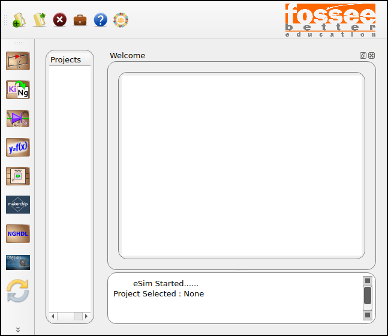
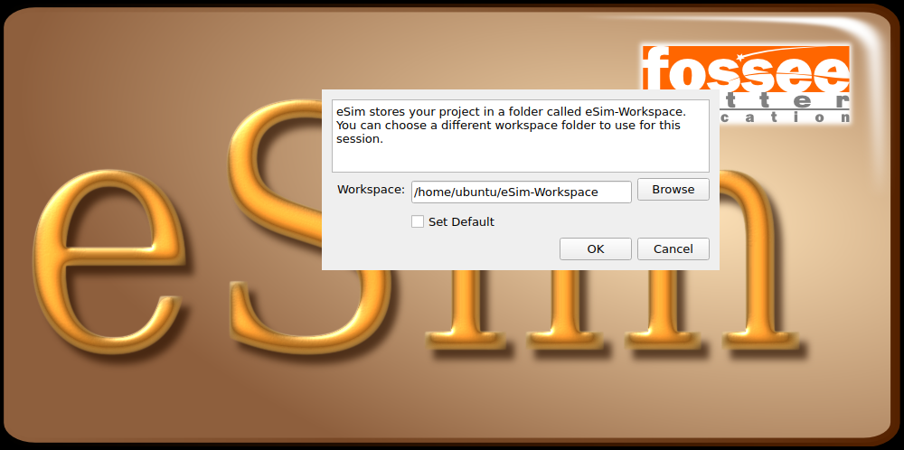

# eSim 2.5 on Ubuntu 25.04: Installation Report

**Screening Task 4 (eSim Upgradation), FOSSEE Winter Internship 2026**

| Item | Detail |
|---|---|
| Submitted by | Shikhar Verma (GitHub: Shikhyy) |
| Date tested | 15 November 2026 |
| Software tested | `eSim-2.5.zip` from the official eSim downloads page |
| Operating system | Ubuntu 25.04 "plucky", x86_64 |
| Fixes are on | branch `installers` of this repository |
| PDF copy | [eSim-2.5-Ubuntu-25.04-Installation-Report.pdf](eSim-2.5-Ubuntu-25.04-Installation-Report.pdf) |

## Summary

The official eSim 2.5 installer cannot complete on Ubuntu 25.04. This report describes ten
problems found while installing it, explains the cause of each, and documents the changes
on this branch that fix them. With those changes, the installer completes in a single pass
on a new Ubuntu 25.04 system (23 min 56 s, exit code 0) and eSim starts.



*Figure 1. eSim 2.5 started on the freshly installed Ubuntu 25.04 system. The log pane reads
"eSim Started......", and the toolbar shows the KiCad, NGHDL and Makerchip launchers.*

| Result | Outcome |
|---|---|
| Problems found | 10: 8 reproduced in test runs, 2 found by code review |
| Problems fixed | 10 |
| Verification | One-shot install on a clean Ubuntu 25.04 container: exit code 0. GHDL 4.1.0, Verilator 4.210, ngspice and KiCad 8.0.8 present, and the eSim window opens |
| Files changed | 3 installer scripts (1 new), and this report |
| Earlier work | P1, P6 and P7 were already described in [REPORT.md](../REPORT.md). The other seven are additional findings (section 7) |

## Contents

1. [Problems at a glance](#1-problems-at-a-glance)
2. [Test setup and method](#2-test-setup-and-method)
3. [Problems and fixes](#3-problems-and-fixes)
4. [Verification](#4-verification)
5. [Observations that are not counted as problems](#5-observations-that-are-not-counted-as-problems)
6. [Limitations](#6-limitations)
7. [Relation to the existing REPORT.md](#7-relation-to-the-existing-reportmd)
8. [Reproducing the results, files changed and evidence index](#8-reproducing-the-results-files-changed-and-evidence-index)

## 1. Problems at a glance

| ID | Problem | Found by | Effect on the install | Fixed in |
|---|---|---|---|---|
| P1 | The official package has no Ubuntu 25.04 support | Reproduced | Stops at once | `install-eSim.sh`, `install-eSim-25.04.sh` |
| P2 | The `installers` dispatcher has a syntax error | Reproduced | Every run fails | `install-eSim.sh` |
| P3 | Version detection prints nothing on 25.04 | Reproduced | Cosmetic | `install-eSim.sh` |
| P4 | `add-apt-repository`, `lsb_release`, `unzip` and `file` are never installed | Reproduced | Stops at the KiCad step on minimal systems | `install-eSim-25.04.sh` |
| P5 | The bundled `nghdl.zip` has no 25.04 support, and the failure is hidden | Reproduced | Stops at the NGHDL step, with no error message | `install-eSim-25.04.sh`, `nghdl-25.04/` |
| P6 | `libcanberra-gtk-module` no longer exists | Reproduced | Stops at the NGHDL step | `nghdl-25.04/` |
| P7 | GHDL 4.1.0 cannot be built with LLVM 20 | Reproduced | Stops at the NGHDL step | `nghdl-25.04/` |
| P8 | The GHDL build calls an unversioned `clang++` | Reproduced | Stops at the NGHDL step | `nghdl-25.04/` |
| P9 | `apt install` without `-y` | Code review | Hangs unattended runs | `install-eSim-25.04.sh` |
| P10 | "KiCad already installed" ends the whole installer | Code review | Ends the install early, before the launcher exists | `install-eSim-25.04.sh` |

*Reproduced* means the failure was observed in a test run and an excerpt is in
[`evidence/`](evidence/). *Code review* means the problem was found by reading the script;
the test runs did not trigger it, so it is documented but untested.

### Difficulty: what each problem interrupts

The installer runs its steps in this order: configuration file, system and Python
dependencies, KiCad, KiCad libraries, NGHDL (GHDL, Verilator and ngspice), the SKY130 PDK,
and, **last of all**, the `esim` launcher and desktop entry. A failure at any earlier step
leaves no `esim` command, so the main eSim GUI cannot be started.

| What it interrupts | Problems |
|---|---|
| Everything, at the first step | P1, P2 |
| The KiCad step, before the GUI launcher is created | P4 |
| The NGHDL step. NGHDL is not the GUI itself, but this installer treats it as mandatory and stops, so the GUI launcher is never created | P5, P6, P7, P8 |
| The whole installer, ended early before the launcher, on a system that already has KiCad 8 | P10 |
| No failure, only reliability or cosmetics | P3, P9 |

## 2. Test setup and method

### 2.1 Environment

| Item | Value |
|---|---|
| Operating system | Ubuntu 25.04 "plucky", from the official `ubuntu:25.04` Docker image |
| Host | GitHub Codespaces, x86_64, 2 vCPU, 8 GB RAM, running Docker |
| Software | `eSim-2.5.zip`, downloaded from `https://static.fossee.in/esim/installation-files/eSim-2.5.zip` (100,868,880 bytes) |
| SHA-256 | `b9860ae26f026930bae589520761f4a57b85d593a2e2cd1ac83d5e5db2f281ed` |
| User | Non-root user `ubuntu` with passwordless `sudo`, as on a normal desktop |
| Input | `n` to the proxy question, `y` to any other prompt |

A container was used instead of a full virtual machine. It provides the real Ubuntu 25.04
userland and package archive, but no init system or display. A virtual display (Xvfb) was
used to capture the screenshots.

### 2.2 Container setup that is not counted as an eSim problem

A bare container is missing things that a desktop installation already has. These were
added by hand and are **not** reported as problems:

- A timezone. Without one, the `tzdata` package asked "Geographic area:" in a loop.
- `sudo` and `ca-certificates`.

In the final verification run, `lsb-release`, `software-properties-common`, `unzip`, `file`
and `clang` were deliberately left out, so that the installer had to install what it needs
itself.

### 2.3 Steps taken

1. Created an `ubuntu:25.04` container and a non-root user, then downloaded and unpacked
   `eSim-2.5.zip` and recorded its checksum.
2. Ran the stock `install-eSim.sh --install`. It stopped at once (P1).
3. Overlaid `Ubuntu/install-eSim.sh` and `install-eSim-25.04.sh` from the `installers`
   branch. The dispatcher could not be parsed (P2). It was rebuilt from the clean dispatcher
   in the official zip, the 25.04 case was added, and version detection was fixed (P3).
4. Re-ran. The Python dependencies installed, then the run stopped at KiCad because
   `add-apt-repository` was missing (P4). After installing it and re-running, KiCad 8.0.8
   installed.
5. The run reached NGHDL and stopped with "Unsupported Ubuntu version" and no error message
   from eSim (P5). A 25.04 script was created by copying NGHDL's 24.04 script.
6. Ran the NGHDL installer on its own. It stopped on `libcanberra-gtk-module` (P6). After
   fixing that and re-running, it stopped again.
7. GHDL's `configure` reported `Unhandled version llvm 20.1.2` (P7). After switching to
   LLVM 18, GHDL, Verilator and ngspice built successfully.
8. Read through `install-eSim-25.04.sh` for problems the runs had not reached (P9, P10).
9. Applied all fixes to the `installers` branch and repeated the whole install in a **new**
   container, using the official zip plus only the files from the branch. It failed in the
   GHDL build with `clang++: not found` (P8). An earlier container had hidden this problem
   because it still had a leftover `clang` package. The problem was fixed.
10. Repeated the whole install once more in another new container, in a single pass with
    no manual steps (section 4).

## 3. Problems and fixes

### P1. The official package has no Ubuntu 25.04 support

> **Found by:** reproduced ([evidence 01](evidence/01-stock-dispatcher-unsupported-25.04.txt))
> · **Effect:** the installer stops at once
> · **Fixed in:** `install-eSim.sh`, `install-eSim-25.04.sh`
> · **Status:** already described in [REPORT.md](../REPORT.md); reproduced here against the 2.5 package

**Symptom**

```
Detected Ubuntu Version:
Unsupported Ubuntu version: 25.04 ()
```

**Cause.** `install-eSim.sh` in `eSim-2.5.zip` selects a version-specific script for Ubuntu
22.04, 23.04 and 24.04 only, and `install-eSim-scripts/` contains no 25.04 script.

**Fix.** A `25.04` case that selects `install-eSim-25.04.sh`:

```diff
         "24.04")
             SCRIPT="$SCRIPT_DIR/install-eSim-24.04.sh"
             ;;
+        "25.04")
+            SCRIPT="$SCRIPT_DIR/install-eSim-25.04.sh"
+            ;;
```

### P2. The `installers` dispatcher cannot be parsed

> **Found by:** reproduced ([evidence 02](evidence/02-installers-dispatcher-syntax-error.txt))
> · **Effect:** every run of this file fails, on every Ubuntu version
> · **Fixed in:** `install-eSim.sh`

**Symptom**

```
install-eSim.sh: line 70: syntax error near unexpected token `}'
```

**Cause.** `Ubuntu/install-eSim.sh` on this branch is a damaged merge. The
`if [[ -f "$SCRIPT" ]]` block in `run_version_script` is cut off after
`bash "$SCRIPT" "$ARGUMENT"`, and the text continues with the body of the `createConfigFile`
function. The `else` branch, the closing `fi` and `}`, and the whole main section of the
dispatcher are missing. The file is 342 lines long, against 84 for the rebuilt dispatcher. The
same error is present in the upstream `FOSSEE/eSim` `installers` branch (checked with
`bash -n` on 15 November 2026).

**Fix.** The file was rebuilt from the clean dispatcher in `eSim-2.5.zip`, with the 25.04
case from P1 added. It passes `bash -n`.

### P3. Version detection prints nothing on 25.04

> **Found by:** reproduced (see the first line of [evidence 01](evidence/01-stock-dispatcher-unsupported-25.04.txt))
> · **Effect:** cosmetic on 25.04
> · **Fixed in:** `install-eSim.sh`

**Symptom.** `Detected Ubuntu Version:` is followed by nothing.

**Cause.** `lsb_release -d | grep -oP '\d+\.\d+\.\d+'` expects a three-part version such as
`22.04.4`. Ubuntu 25.04 reports `Ubuntu 25.04`. The script chooses its installer from
`VERSION_ID`, so the empty value is only a wrong message on 25.04.

**Fix**

```diff
-    FULL_VERSION=$(lsb_release -d | grep -oP '\d+\.\d+\.\d+')
+    FULL_VERSION=$(lsb_release -ds | grep -oP "\d+\.\d+(\.\d+)?" | head -1)
```

### P4. Tools that the installer needs are never installed

> **Found by:** reproduced ([evidence 03](evidence/03-add-apt-repository-not-found.txt))
> · **Effect:** stops at the KiCad step on minimal systems
> · **Fixed in:** `install-eSim-25.04.sh`

**Symptom**

```
sudo: add-apt-repository: command not found

Error! Kindly resolve above error(s) and try again.
Aborting Installation...
```

**Cause.** The script uses `add-apt-repository`, `lsb_release` and `unzip` but never
installs `software-properties-common`, `lsb-release` or `unzip`. Desktop installations
usually include them, while minimal and server installations do not. `file` is also missing,
which produced `/usr/bin/file: No such file or directory` during the NGHDL configure step.

**Fix**

```diff
+    echo "Installing prerequisites (add-apt-repository, lsb_release, unzip, file)..."
+    sudo apt-get install -y software-properties-common lsb-release unzip file
```

### P5. The bundled `nghdl.zip` has no 25.04 support, and the failure is hidden

> **Found by:** reproduced ([evidence 04](evidence/04-nghdl-unsupported-and-silent-stop.txt))
> · **Effect:** stops at the NGHDL step, with no error message from eSim
> · **Fixed in:** `install-eSim-25.04.sh`, `nghdl-25.04/install-nghdl-25.04.sh`

**Symptom.** NGHDL's own installer prints the message below, and eSim then stops without any
message of its own.

```
Detected Ubuntu Version:
Unsupported Ubuntu version: 25.04 ()
```

**Cause.** There are two:

1. The `nghdl.zip` inside eSim 2.5 uses the same version dispatcher as eSim, with no 25.04
   case and no 25.04 script.
2. `installNghdl` sets `trap "" ERR` and then runs `./install-nghdl.sh --install`. Under
   `set -e` the shell exits when that command fails, but the error handler is disabled, so
   nothing is printed.

**Fix.** After unzipping, the script adds the 25.04 case to NGHDL's dispatcher and copies in
`nghdl-25.04/install-nghdl-25.04.sh`. This step runs only when the dispatcher lacks the case,
so re-runs are safe. A failing NGHDL install now reports itself. (The `perl` command is
abbreviated here; the script contains the exact text.)

```diff
+    if ! grep -q "\"25.04\")" install-nghdl.sh; then
+        cp "$eSim_Home/install-eSim-scripts/nghdl-25.04/install-nghdl-25.04.sh" install-nghdl-scripts/
+        perl -0pi -e '...insert the "25.04" case after the "24.04" case...' install-nghdl.sh
+    fi
 ...
-    ./install-nghdl.sh --install       # Install NGHDL
+    if ! ./install-nghdl.sh --install; then
+        echo -e "\n\nERROR: NGHDL installation failed. See the messages above."
+        exit 1
+    fi
```

### P6. `libcanberra-gtk-module` no longer exists

> **Found by:** reproduced ([evidence 05](evidence/05-libcanberra-gtk-module-missing.txt))
> · **Effect:** stops at the NGHDL step
> · **Fixed in:** `nghdl-25.04/install-nghdl-25.04.sh`
> · **Status:** already described in [REPORT.md](../REPORT.md)

**Symptom**

```
Error: Package 'libcanberra-gtk-module' has no installation candidate

Error! Kindly resolve above error(s) and try again.
Aborting Installation...
```

**Cause.** The GTK 2 package was removed from Ubuntu. Only `libcanberra-gtk3-module` remains.
The NGHDL installer in `eSim-2.5.zip`, and `FOSSEE/nghdl` `installers/Ubuntu/install-nghdl.sh`,
still request the removed package.

**Fix**

```diff
-    sudo apt install -y libcanberra-gtk-module libcanberra-gtk3-module
+    sudo apt install -y libcanberra-gtk3-module
```

### P7. GHDL 4.1.0 cannot be built with LLVM 20

> **Found by:** reproduced ([evidence 06](evidence/06-ghdl-unhandled-llvm-20.txt))
> · **Effect:** stops at the NGHDL step
> · **Fixed in:** `nghdl-25.04/install-nghdl-25.04.sh`
> · **Status:** already described in [REPORT.md](../REPORT.md)

**Symptom**

```
Unhandled version llvm 20.1.2

Error! Kindly resolve above error(s) and try again.
Aborting Installation...
```

**Cause.** The script installs the default `llvm` and `llvm-dev`, which are LLVM 20 on Ubuntu
25.04. The `configure` script of GHDL 4.1.0 does not support that version. The shipped NGHDL
installers still call the unversioned `llvm-config`.

**Fix.** Install LLVM 18 and point GHDL at it:

```diff
-    sudo apt install -y llvm llvm-dev
+    sudo apt install -y llvm-18 llvm-18-dev
-    sudo apt install -y clang
+    sudo apt install -y clang-18
-    ./configure --with-llvm-config=/usr/bin/llvm-config
+    CXX=clang++-18 ./configure --with-llvm-config=/usr/bin/llvm-config-18
```

### P8. The GHDL build calls an unversioned `clang++`

> **Found by:** reproduced ([evidence 07](evidence/07-clangxx-not-found.txt))
> · **Effect:** stops at the NGHDL step
> · **Fixed in:** `nghdl-25.04/install-nghdl-25.04.sh`

**Symptom**

```
/bin/sh: 1: clang++: not found
make[1]: *** [src/ortho/llvm6/Makefile:20: llvm-cbindings.o] Error 127
make: *** [Makefile:410: ghdl1-llvm] Error 2
```

**Cause.** GHDL's build defaults to the compiler `clang++`. With only the versioned
`clang-18` installed, the command that exists is `clang++-18`. An earlier test container had a
leftover unversioned `clang` package, which hid the problem. The clean-container run exposed
it.

**Fix.** `CXX=clang++-18` on the `configure` line, shown in P7. Installing the unversioned
`clang` instead would add LLVM 20's compiler and mix compiler versions.

### P9. `apt install` without `-y` (code review)

> **Found by:** code review, not triggered in the test runs
> · **Effect:** unattended runs hang or abort
> · **Fixed in:** `install-eSim-25.04.sh`

**Cause.** `sudo apt install python3-virtualenv` waits for confirmation. An interactive user
can answer, but scripted installs cannot.

**Fix**

```diff
-    sudo apt install python3-virtualenv
+    sudo apt install -y python3-virtualenv
```

### P10. "KiCad already installed" ends the whole installer (code review)

> **Found by:** code review, not triggered in the test runs
> · **Effect:** the installer ends early with success, before the launcher exists
> · **Fixed in:** `install-eSim-25.04.sh`

**Cause.** In `installKicad`, when KiCad 8 is already installed the function runs `exit 0`,
which ends the entire installer. The KiCad library, NGHDL, the SKY130 PDK and the `esim`
launcher are then never set up, and the user sees no error. The test runs did not reach this
branch, because KiCad was not installed beforehand.

**Fix**

```diff
-                exit 0
+                return 0
```

## 4. Verification

### 4.1 One-shot installation

A new `ubuntu:25.04` container was prepared as described in section 2.2. A fresh copy of the
official `eSim-2.5.zip` was unpacked, and only the three files from this branch were laid
over it. The installer was then run once, with no manual steps between start and finish.

| Start | End | Duration | Exit code |
|---|---|---|---|
| 2026-11-15 12:40:42 UTC | 2026-11-15 13:04:38 UTC | 23 min 56 s | 0 |

The time is mostly spent compiling GHDL, Verilator and ngspice on 2 vCPUs. The installer
ended with:

```
-----------------eSim Installed Successfully-----------------
```

### 4.2 Checks after the installation

Full output: [evidence 08](evidence/08-post-install-checks.txt).

| Check | Result |
|---|---|
| `ghdl --version` | GHDL 4.1.0 (tarball) [Dunoon edition] |
| `verilator --version` | Verilator 4.210 2021-07-07 |
| `kicad-cli --version` | 8.0.8 |
| `ngspice`, `esim` | installed (`/usr/bin/ngspice`, `/usr/bin/esim`) |
| eSim virtual environment | Python 3.13.3; `PyQt5.QtWidgets`, `matplotlib`, `watchdog` and `hdlparse` import without errors |
| SKY130 library | `/usr/share/local/sky130_fd_pr` present |
| GHDL build settings | `llvm-config-18` and `clang++-18`, as shown in the build log |

### 4.3 Graphical start-up

eSim was started on the same installation under a virtual display (Xvfb). Figure 2 shows the
splash screen and the workspace dialog that eSim displays on first start. Figure 1, at the top
of this report, shows the main window after the dialog was confirmed.



*Figure 2. The eSim 2.5 splash screen and the workspace dialog, on Ubuntu 25.04.*

## 5. Observations that are not counted as problems

- **`psutil` in the virtual environment.** `psutil` is installed with `apt`, outside the eSim
  virtual environment, so it cannot be imported there. Nothing under `src/` imports it.
- **Blank Welcome pane.** The Welcome pane in the main window is empty, and the launch log
  says that `welcome.html` was not found. The file is at `library/browser/welcome.html` in the
  bundle, while the application looks under `src/browser/library/browser/`. This looks like a
  path problem in eSim 2.5 itself and not an installer problem. It was not investigated
  further.
- **Harmless `rm` message.** `rm: cannot remove '/usr/bin/ngspice': No such file or
  directory` is printed on a fresh system where no earlier ngspice exists. It has no effect and
  was left unchanged.

## 6. Limitations

- Only x86_64 was tested, in a container with a virtual display, not on a physical desktop or
  in a full virtual machine. Package versions are those in the Ubuntu 25.04 archive on
  15 November 2026.
- The screenshots show eSim starting. No circuit was drawn or simulated, so correct
  simulation results from ngspice and GHDL are not covered; the checks show only that they
  install and report their versions.
- P9 and P10 were found by reading the code and are not covered by a failing test run.

## 7. Relation to the existing REPORT.md

[REPORT.md](../REPORT.md) was added in September 2025. It already describes four 25.04 fixes
(LLVM 18, the `llvm-config-18` path, the libcanberra package and the KiCad 8.0.8 version
pin), together with the 25.04 installer script and its dispatcher entry.

When this work started, those fixes were **not** present in the files that were tested: the
NGHDL installer inside `eSim-2.5.zip`, and `FOSSEE/nghdl` `installers/Ubuntu/install-nghdl.sh`,
still contained the old lines, and the `installers` dispatcher could not be parsed.

| Findings | Status |
|---|---|
| P1, P6, P7 | Confirm and re-apply, for the 2.5 package, problems that were already known |
| P2, P3, P4, P5, P8, P9, P10 | Additional findings from this test |

## 8. Reproducing the results, files changed and evidence index

### 8.1 Reproducing

```bash
docker run -it --name esim25 ubuntu:25.04 bash
# inside the container:
apt-get update && apt-get install -y sudo ca-certificates curl unzip
# create a sudo user, download and unzip eSim-2.5.zip, then copy these files from this branch:
#   Ubuntu/install-eSim.sh                            -> ./install-eSim.sh
#   Ubuntu/install-eSim-scripts/install-eSim-25.04.sh -> ./install-eSim-scripts/
#   Ubuntu/install-eSim-scripts/nghdl-25.04/          -> ./install-eSim-scripts/nghdl-25.04/
chmod +x install-eSim.sh install-eSim-scripts/*.sh
./install-eSim.sh --install     # answer "n" to the proxy question
```

### 8.2 Files changed

| File | Change |
|---|---|
| `Ubuntu/install-eSim.sh` | Rebuilt dispatcher: syntax error removed, 25.04 case added, version detection fixed (P1, P2, P3) |
| `Ubuntu/install-eSim-scripts/install-eSim-25.04.sh` | Installs its own prerequisites, adds 25.04 support to the bundled NGHDL, reports NGHDL failures, `-y` on the virtualenv install, KiCad "already installed" no longer ends the install (P4, P5, P9, P10) |
| `Ubuntu/install-eSim-scripts/nghdl-25.04/install-nghdl-25.04.sh` | New NGHDL installer for 25.04: LLVM 18, `clang++-18`, no `libcanberra-gtk-module` (P5, P6, P7, P8) |

### 8.3 Evidence index

| File | Content |
|---|---|
| [01-stock-dispatcher-unsupported-25.04.txt](evidence/01-stock-dispatcher-unsupported-25.04.txt) | Stock dispatcher output on 25.04 (P1, P3) |
| [02-installers-dispatcher-syntax-error.txt](evidence/02-installers-dispatcher-syntax-error.txt) | `bash -n` on the original `installers` dispatcher (P2) |
| [03-add-apt-repository-not-found.txt](evidence/03-add-apt-repository-not-found.txt) | End of the log where the KiCad step fails (P4) |
| [04-nghdl-unsupported-and-silent-stop.txt](evidence/04-nghdl-unsupported-and-silent-stop.txt) | End of the log where NGHDL is rejected (P5) |
| [05-libcanberra-gtk-module-missing.txt](evidence/05-libcanberra-gtk-module-missing.txt) | `apt` error for the removed package (P6) |
| [06-ghdl-unhandled-llvm-20.txt](evidence/06-ghdl-unhandled-llvm-20.txt) | GHDL `configure` rejecting LLVM 20 (P7) |
| [07-clangxx-not-found.txt](evidence/07-clangxx-not-found.txt) | GHDL build failing on `clang++` (P8) |
| [08-post-install-checks.txt](evidence/08-post-install-checks.txt) | Checks after the one-shot installation (section 4) |
| [eSim-2.5-main-window.png](evidence/eSim-2.5-main-window.png) | Figure 1 |
| [eSim-2.5-running-on-ubuntu-25.04.png](evidence/eSim-2.5-running-on-ubuntu-25.04.png) | Figure 2 |
